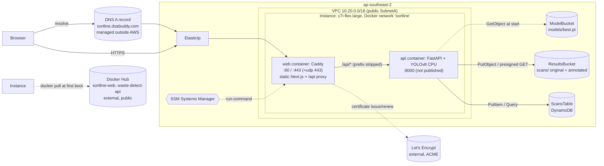

# AWS Architecture

This document describes how Sortline (waste detection plus a segregation-facility dashboard) runs on AWS: what each service does, how requests flow, and where the sharp edges are. Names match `infra/template.yaml` (stack name default: `waste-detect`).

> **Verification status.** The single-EC2 + Caddy design below replaced an earlier CloudFront + Lambda + ALB design (that earlier design was deployed and tested). This design has been tested locally with `docker compose` (site, `/dashboard`, `/api/detect`). Its AWS deployment, the real S3/DynamoDB persistence and the Let's Encrypt certificate have **not** been verified yet; the persistence code was tested only against a mocked AWS (moto).

## Region

Everything lives in one Region: **ap-southeast-2** (`REGION` in `infra/scripts/env-config`, overridable by env var). This is the project Region assigned to the AWS project.

- All resources (VPC, EC2, Elastic IP, S3, DynamoDB) are created in the selected Region.
- Not used, by design: CloudFront, Lambda@Edge, CloudFormation StackSets, cross-Region replication, multi-Region KMS keys, Route 53 latency/geo/failover routing.
- Confirm your Region in AWS Settings > View all projects > Overview > Additional Info > Region (or check `~/.aws/config`).

## Architecture diagram



```
          Browser --(DNS A record)--> sortline.dsabuddy.com --> ElasticIp
                                                                  |
                                          :80/:443 (+udp 443)     |   Ec2Sg: 80, 443 tcp, 443 udp from 0.0.0.0/0
                       +------------------------------------------v-------------------------+
                       | Instance (EC2, SubnetA, c7i-flex.large)   docker network "sortline" |
                       |                                                                      |
                       |  web  = Caddy  -- static Next.js export (/ , /dashboard/)            |
                       |         |      -- automatic HTTPS (Let's Encrypt)                    |
                       |         +--> /api/*  (prefix stripped) --> api:8000                  |
                       |  api  = FastAPI + YOLOv8 (CPU)  -- port 8000 not published           |
                       +-----------+------------------+-------------------+-------------------+
                                   |                  |                   |
                          ModelBucket (best.pt)  ResultsBucket (scans/)  ScansTable (DynamoDB)
                          GetObject at start     original + annotated     one item per scan
```

## Services and why

| Service | Logical resource(s) | Why it is used |
|---|---|---|
| CloudFormation | stack `waste-detect` (`template.yaml`) | One template defines everything. `deploy.sh` runs `aws cloudformation deploy` with `CAPABILITY_IAM`; no packaging step. |
| EC2 | `Instance`, `InstanceRole`, `InstanceProfile`, `Ec2Sg` | Runs both containers (`c7i-flex.large` default, AL2023, 30 GB encrypted gp3, IMDSv2 required). User data installs Docker, creates the `sortline` network, pulls both images (retrying every 30 s until they exist), and starts `api` and `web` with `--restart always`. |
| Elastic IP | `ElasticIp`, `ElasticIpAssociation` | Stable public address so the DNS A record survives instance stop/start. |
| Caddy (in the `web` container) | image from `WebImageUri` (built from `frontend/Dockerfile` + `Caddyfile`) | Serves the static Next.js export, obtains and renews the Let's Encrypt certificate for `DomainName` automatically, redirects HTTP to HTTPS, adds security headers, caps request bodies at 12 MB, and reverse-proxies `/api/*` to `api:8000` with the `/api` prefix stripped. Certificates persist in the `caddy_data` Docker volume. |
| FastAPI + YOLOv8 (the `api` container) | image from `ImageUri` (built from `backend/`) | CPU inference plus persistence and analytics (`/detect`, `/stats`, `/scans`, `/health`). Not published on the host; reachable only from the `web` container over the Docker network. |
| S3 (model) | `ModelBucket`, `ModelBucketPolicy` | Holds YOLO weights (`models/best.pt`, parameter `ModelKey`). Versioned, SSE-S3, public access blocked, TLS-only. Keeps the weights out of the Docker image. |
| S3 (results) | `ResultsBucket`, `ResultsBucketPolicy` | Stores the original and annotated image of every scan (`scans/<date>/<scan_id>/original.jpg`, `annotated.jpg`). Private, SSE-S3, public access blocked, TLS-only, objects under `scans/` expire after 30 days. The dashboard shows them through 1-hour presigned URLs. |
| DynamoDB | `ScansTable` | One item per scan: partition key `day` (UTC date), sort key `sk` (`<timestamp>#<scan_id>`); attributes include line, class counts, total, confidence, inference time, image keys, detections. On-demand billing, SSE enabled. Queried per day by `/stats` and `/scans`. |
| Docker Hub (external) | `ImageUri`, `WebImageUri` | Hosts both images in public repositories, pulled anonymously. Not managed by the stack. Build and push with `infra/scripts/build-push.sh` (api) and `build-push-web.sh` (web) after `docker login`. |
| VPC / SG | `Vpc`, `SubnetA`, `Igw`, `PublicRouteTable`, `Ec2Sg` | `Ec2Sg` allows tcp 80, tcp 443 and udp 443 (HTTP/3) from anywhere. Port 8000 and SSH are not open. No NAT gateway (cost) because the instance is in a public subnet. |
| IAM | `InstanceRole` (SSM core + inline `ModelRead` and `ScanStorage`) | Least privilege: read `ModelBucket`; put/get objects in `ResultsBucket`; PutItem/GetItem/Query/BatchWriteItem/DeleteItem on `ScansTable`. |
| SSM | `AmazonSSMManagedInstanceCore`; AMI via `{{resolve:ssm:...al2023...}}` | Shell-less access (restart containers, run commands) with no SSH key. Also resolves the latest AL2023 AMI at deploy time. |
| DNS (outside AWS) | A record for `DomainName` | Managed at the domain provider (not Route 53 in this stack). Must point at the `ElasticIp` output. |

## Request flows

### Page load

1. The browser resolves `sortline.dsabuddy.com` to the Elastic IP and connects to Caddy on 443 (HTTP on 80 is redirected to HTTPS).
2. Caddy serves the static export from `/srv`: `/` (scanner) and `/dashboard/`. Files under `/_next/static/*` get `Cache-Control: public, max-age=31536000, immutable`.
3. The page calls `GET /api/health` to show backend status; the dashboard polls `/api/stats` and `/api/scans` every 10 s.

### `POST /api/detect?conf=0.40&line=line-1`

1. The frontend (`frontend/lib/api.ts`) first resizes the image to at most 1600 px on the long side (JPEG), then sends the multipart form to `/api/detect`.
2. Caddy strips `/api`, enforces the 12 MB body cap and proxies to `api:8000/detect` (60 s response header timeout).
3. FastAPI (`backend/app/main.py`) checks the model is loaded (503 if not), size (413), magic bytes JPEG/PNG/WebP (415), decodability (400), pixel count (413) and the `line` value (422), then runs YOLOv8 on CPU under a lock.
4. It then saves the original and annotated JPEGs to `ResultsBucket` and the scan record to `ScansTable` (best effort: a storage failure is logged and the request still returns 200; storage is skipped entirely when `RESULTS_BUCKET`/`SCANS_TABLE` are unset).
5. The JSON response contains `detections`, `counts`, `image` (annotated JPEG as base64 data URL), `inference_ms` and `scan_id`.

### Dashboard data

- `GET /api/stats?days=7&line=` returns totals, per-class counts, per-day and per-hour series, top class, purity, and estimated weight and recovery value. Weight, value and purity are rough estimates from per-class constants in `backend/app/store.py`.
- `GET /api/scans?limit=24&line=` returns recent scans with 1-hour presigned S3 URLs for both images.
- Demo data can be loaded with `backend/scripts/seed.py` (items are flagged `demo` and shown with a "demo" badge); see `deploy.md`.

## Security model

- Public exposure is limited to ports 80/443 on the instance. The API container has no published port; only Caddy reaches it over the Docker network.
- HTTPS everywhere with an automatically managed certificate; HSTS, `X-Frame-Options: DENY`, `nosniff` and a referrer policy are set by Caddy.
- Both buckets block public access and deny non-TLS requests. Result images are served only through short-lived presigned URLs.
- EC2: IMDSv2 required, encrypted root volume, no SSH (use SSM), instance role limited to what is listed above.
- Backend validates upload type by magic bytes, caps size at 10 MB and image area at 50 megapixels; the container runs as non-root user `app` (uid 10001).
- The API endpoints (`/detect`, `/stats`, `/scans`) have **no authentication**. Anyone who can reach the site can upload images and read scan data and result images. Fine for a demo; add auth before real use.
- Backend CORS defaults to `*` (`CORS_ORIGINS`); the site and API are same-origin through Caddy, so it can be tightened.
- Human IAM access is managed by AWS for this project; the template creates only service roles.

## Known limits

- **Single instance, no HA.** One EC2 instance; instance loss or an AZ outage means downtime. `--restart always` covers container crashes and reboots only.
- **Serialized inference.** A `threading.Lock` guards the model (ultralytics predictors are not thread-safe), so concurrent requests queue.
- **Certificate depends on DNS.** Caddy can obtain a certificate only after the A record for `DomainName` points at the Elastic IP and ports 80/443 are reachable. Until then HTTPS fails. If the DNS record is behind a proxy (for example Cloudflare "proxied"), issuance may fail; use "DNS only" until the certificate exists.
- **Let's Encrypt rate limits.** Repeatedly recreating the `caddy_data` volume re-requests certificates and can hit rate limits. Keep the volume.
- **Updates are manual.** User data runs only on first boot. After the stack is updated, or when you push new images, run `infra/scripts/update-instance.sh` to pull and recreate the containers.
- **EC2 in a public subnet** with an Elastic IP (no NAT). Protected by `Ec2Sg`; a private subnet plus a load balancer would be stronger but costs more.
- **`/scans` reads back up to 90 days of partitions** sequentially, so it is slower on a nearly empty table.
- **Hours in `by_hour` are UTC.**
- **Cold start.** Model download plus warm-up takes time; `/health` shows `model_loaded: false` until done, and `/detect` returns 503. The model is downloaded only when the `api` container starts, so a late model upload needs a container restart (`update-instance.sh`).
- **Free-plan instance types.** The free plan rejected `t3.*` (for example `t3.medium`) with "not eligible for Free Tier". The default `c7i-flex.large` (4 GB) is eligible. List eligible types with `aws ec2 describe-instance-types --filters Name=free-tier-eligible,Values=true`.
- **Public images.** The Docker Hub repositories are public, so anyone can pull them. They contain no secrets; the weights stay in `ModelBucket`.
- **Not load tested; persistence not yet verified on real AWS.**

## Rough monthly cost drivers

Approximate on-demand figures for ap-southeast-2; verify in the AWS pricing pages and set a budget/spend limit.

| Driver | Notes |
|---|---|
| EC2 `c7i-flex.large` | Dominant cost; check current ap-southeast-2 on-demand pricing and free-plan credits. Stop or destroy when idle. |
| EBS 30 GB gp3 | A few dollars. |
| Elastic IP / public IPv4 | Hourly charge for the public IPv4 address. |
| S3, DynamoDB | Small at demo traffic (on-demand DynamoDB; scan images expire after 30 days). |
| Data transfer out | Grows with annotated-image responses and dashboard image views. |
| Free plan | Free-tier accounts may restrict instance types or services; see `deploy.md` for the plan check. |

There is no load balancer, CloudFront or Lambda in this design, which removes the largest fixed costs of the earlier version. Cheapest option for demos: deploy, test, then run `destroy.sh`. Decide whether to keep or clean up created resources after testing.

## Teardown

Run `infra/scripts/destroy.sh`. It empties `ModelBucket` and `ResultsBucket` (all object versions), deletes the stack (including `ScansTable` and the Elastic IP), and waits for completion. A stray bucket `waste-detect-cfn-artifacts-<account>-<region>` may exist from an early packaging attempt; it is not part of the stack and can be deleted. Remove the DNS A record yourself. See `deploy.md` section "Clean up".

## Stack outputs

| Output | Used for |
|---|---|
| `ElasticIp` | Value for the DNS A record |
| `SiteUrl` | `https://<DomainName>` |
| `InstanceId` | SSM commands (`update-instance.sh`) |
| `ModelBucketName` | `upload-model.sh` target |
| `ResultsBucketName` | Scan images (and `seed.py`) |
| `ScansTableName` | Scan records (and `seed.py`) |

## Template parameters

| Parameter | Default | Notes |
|---|---|---|
| `InstanceType` | `c7i-flex.large` | 4 GB, free-plan eligible. Override with `./deploy.sh InstanceType=<type>` |
| `ImageUri` | `docker.io/tanman0215/waste-detect-api:latest` | API image pulled at first boot |
| `WebImageUri` | `docker.io/tanman0215/sortline-web:latest` | Caddy + Next.js image pulled at first boot |
| `DomainName` | `sortline.dsabuddy.com` | Passed to Caddy as `SITE_ADDRESS`; must resolve to `ElasticIp` |
| `ModelKey` | `models/best.pt` | S3 key in `ModelBucket` |
