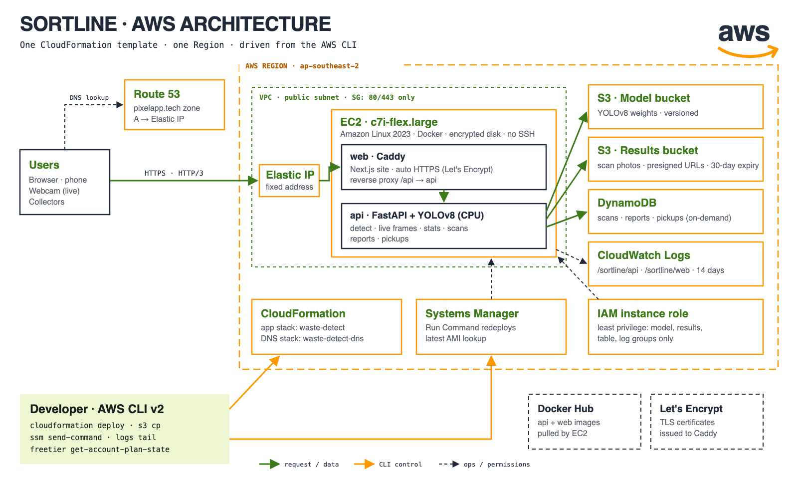
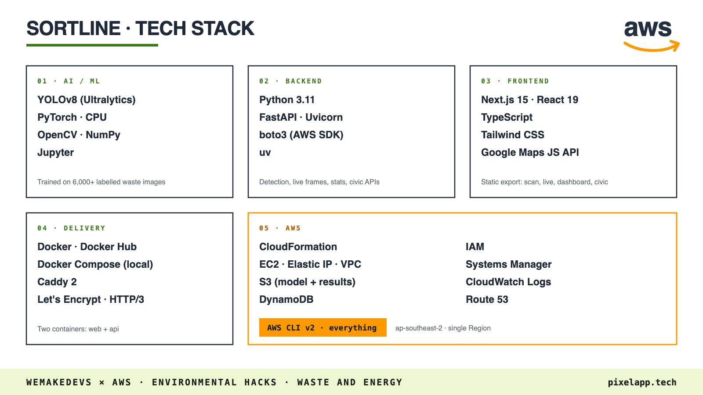

# Sortline

**One photo in. Sorted, cleaned, paid, counted.**

Sortline turns a phone camera into a waste sorter. A YOLOv8 model detects plastic, metal, glass, paper, cardboard and organic waste in a photo or live camera feed, and the same model powers a small civic loop around it: reporting garbage spots, verifying cleanups, pricing recyclables and counting everything for the city.

Live at **[pixelapp.tech](https://pixelapp.tech)**. Built for WeMakeDevs × AWS Environmental Hacks (Bharat Builds Tour, Event 02), Waste and Energy track.



## The product

| Step | Who | What it does |
|---|---|---|
| **Scan** (`/scan`, `/live`) | Anyone | Upload a photo or point a webcam. Each item is boxed, labelled with a confidence score, and mapped to the right bin. Live mode runs at about 5-8 fps on CPU. |
| **Report** (`/report`) | Citizens | Snap a garbage pile with GPS. The AI tags what is in it and the spot joins the cleanup queue. Untouched for 48 h, it escalates. |
| **Clean** (`/cleanup`) | Cleanup crews | Crews upload an after photo. The report closes only if the model finds no waste left, so "done" means done. |
| **Sell** (`/pickup`, `/collect`) | Households, collectors | Photograph a bag of sorted recyclables and get a price estimate from its detected composition. Collectors accept and complete the pickup. |
| **Count** (`/dashboard`) | Cities and recyclers | Kilograms by class, stream purity, estimated recovery value, spots cleaned and CO₂e avoided versus landfill. |

## Tech stack



| Layer | Technology |
|---|---|
| Frontend | Next.js 15 (static export), React 19, TypeScript, Tailwind CSS, Google Maps JavaScript API |
| Web server | Caddy (automatic HTTPS via Let's Encrypt, security headers, `/api/*` reverse proxy) |
| Backend | Python 3.11, FastAPI, Uvicorn, boto3 |
| ML | Ultralytics YOLOv8, PyTorch (CPU), OpenCV; trained on a ~6,000-image Roboflow waste dataset (`model/`) |
| Packaging | Docker (two images: `api` and `web`), Docker Compose for local runs, `uv` for Python deps |
| Infrastructure as code | AWS CloudFormation (`infra/template.yaml`, `infra/dns.yaml`) plus shell scripts in `infra/scripts/` |

## AWS services used

Everything runs in one Region, **ap-southeast-2**.

| Service | Role in Sortline |
|---|---|
| **Amazon EC2** | One `c7i-flex.large` instance (Amazon Linux 2023) runs the `web` (Caddy + Next.js) and `api` (FastAPI + YOLOv8) containers. |
| **Elastic IP** | Stable public address for the DNS records. |
| **Amazon VPC** | Dedicated VPC, public subnet and a security group that opens only ports 80/443. |
| **Amazon S3** | `ModelBucket` holds the YOLO weights; `ResultsBucket` stores original and annotated scan, report and pickup images (served through presigned URLs, 30-day expiry). |
| **Amazon DynamoDB** | `ScansTable` (on-demand) stores scans, garbage reports and pickup requests. |
| **Amazon Route 53** | Hosted zone for `pixelapp.tech` (apex and `www` A records). |
| **AWS CloudFormation** | Two stacks: `waste-detect` (app) and `waste-detect-dns` (DNS). |
| **AWS IAM** | Least-privilege instance role scoped to the buckets, table and log groups. |
| **AWS Systems Manager** | Shell-less instance access (no SSH) for container updates; resolves the latest AL2023 AMI. |
| **Amazon CloudWatch Logs** | `/sortline/api` and `/sortline/web` log groups, 14-day retention. |

Full architecture, request flows, security model and cost notes: [`AWS.md`](AWS.md).

## Repository layout

```
frontend/   Next.js app + Caddyfile + Dockerfile
backend/    FastAPI service (detection, stats, reports, pickups)
model/      YOLOv8 training notebook, sample results
infra/      CloudFormation templates and deploy/update/destroy scripts
```

## Run locally

Put the weights at `model/weights/best.pt`, then:

```bash
docker compose up --build
# open http://localhost:8080
```

Persistence (S3/DynamoDB) is off locally, so the dashboard stays empty. See [`backend/README.md`](backend/README.md) for running the API on its own.

## Deploy to AWS

See [`deploy.md`](deploy.md). In short: build and push the images (`infra/scripts/build-push.sh`, `build-push-web.sh`), upload the model (`upload-model.sh`), run `deploy.sh` and `deploy-dns.sh`, and tear down with `destroy.sh`.

## Team

| Name | GitHub |
|---|---|
| Tanmay Gupta | [@Tanmay0215](https://github.com/Tanmay0215) |
| Mohit Maulekhi | [@mohitmaulekhi](https://github.com/mohitmaulekhi) |
